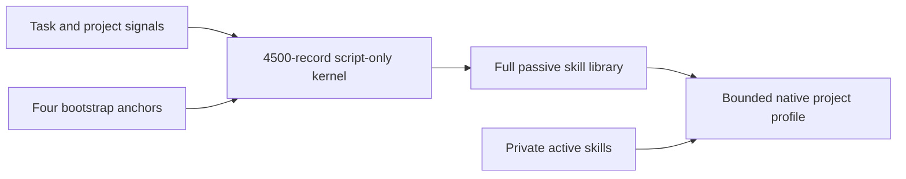

# November 2026 Research And Maintenance

Snapshot: **2026-11-16**. Author: **Ivan Srednoff (Иван Среднёв)**,
[Srednoff.agency](https://srednoff.agency). Maintenance release:
`v2.1.2-20261116`; runtime compatibility stays `v2.1.2`.

## Scope And Evidence

The entire original 396-skill public catalog was run through metadata, local
reference, duplicate-body and resource-integrity checks. The resulting catalog
contains **416 skills**. **196 existing workflows** received specific decisions
and acceptance evidence; shared boilerplate was removed from **189** files.
Other useful existing content was preserved rather than rewritten for volume.

The maintenance inventory covers every skill and resource hash. Its source-family
mapping is an index of useful primary references, not a certification that every
API statement or workflow was independently tested. Real model task validation
is explicitly `not-run`. Unmapped topics remain `needs-domain-review` rather
than being silently marked current. This release does not claim 300% token ROI,
universal skill quality, model superiority, or guaranteed user satisfaction.

## Research Decisions

The full snapshot has **47 source cards**, including **11 immutable repository
revisions**, in `.codex/srednoff-os/maintenance-sources.json`. Stars and activity
are dated discovery context, never quality scores. No new third-party skill,
executable, plugin, account connection or prompt bundle was blindly installed.

| Source | Verified finding | Decision |
|---|---|---|
| [OpenAI skill guidance](https://developers.openai.com/blog/rethinking-skills-and-prompts-for-gpt-6-astra) | Discovery metadata consumes context; task-specific guidance matters | Remove repeated itineraries, bound profiles, keep the kernel script-only |
| [OpenAI skill evaluation](https://developers.openai.com/blog/eval-skills) | Routing and task artifacts are different evidence | Separate structural, source, routing and behavioral results |
| [Vercel agent-skills](https://github.com/vercel-labs/agent-skills) | Current React/performance workflows; file-level licensing still matters | Author narrow RSC/cache workflows; no wholesale rule or code import |
| [Impeccable](https://github.com/pbakaus/impeccable) | Current runtime downloads and telemetry require review | Adapt critique concepts; no engine, hooks or telemetry enabled |
| [Expo skills](https://github.com/expo/skills) | Official plugin, experimental APIs and paid EAS paths are distinct | Prefer an existing official plugin and version-specific release checks |
| [Supabase skills](https://github.com/supabase/agent-skills) | Useful Postgres references; not every task needs a full catalog | Add a narrow lock-budget workflow and avoid duplicate vendor bundles |
| [Playwright CLI](https://github.com/microsoft/playwright-cli) | Browser annotation, tests and page tools have separate trust boundaries | Add annotation-to-fix workflow and preserve session/account scope |
| [Google Ads MCP](https://github.com/googleads/google-ads-mcp/blob/main/README.md) | Upstream includes asset/label/upload writes, not only reports | Disable mutation namespaces for reporting; diff tool inventory before adopting changes |
| [Google conversions](https://developers.google.com/google-ads/api/docs/conversions/overview) | New offline ingestion must check Data Manager eligibility | Do not assume legacy upload access; reconcile accepted versus attributed results |
| [Yandex changelog](https://yandex.ru/dev/direct/doc/ru/changelog) | Placement/default changes can invalidate old assumptions | Add effective-geo/placement drift audit, not automatic optimization |
| [Khronos validator](https://github.com/KhronosGroup/glTF-Validator) | Structural issues and asset stats are machine-readable | Add reproducible validation plus target-viewer evidence |
| [Three.js](https://threejs.org/docs/pages/WebGPURenderer.html) | Backend fallback is supported but parity still needs testing | Test WebGPU and forced WebGL2 rather than making blanket experimental/stable claims |
| [Blender export docs](https://docs.blender.org/manual/en/5.1/addons/import_export/scene_gltf2.html) | Export changes topology/material representation | Separate authoring, topology/UV and shipped-asset acceptance |
| [Google AI Search](https://developers.google.com/search/docs/appearance/ai-features) | No special AI text file/markup is required | Correct llms.txt/GEO claims; keep crawl/index evidence distinct from observed citations |
| [MCP specification](https://modelcontextprotocol.io/specification/2026-07-28) | Wire revision and optional extensions require actual host support | Preserve compatibility-first migration; do not force SDK or model upgrades |
| [DTCG](https://www.designtokens.org/tr/2025.10/format/) | Typed aliases and generated outputs need drift checks | Add a token CI workflow; do not describe the community report as a W3C Recommendation |

The Claude edition still resolved to the same donor commit `d5292137` used in
October; no invented new donor features were imported. OpenAI/Anthropic skill
collections do not establish one blanket license in repository metadata.
Per-file review remains required. The Blender Lab runtime page could not be
freshly fetched, so it is not presented as newly runtime-verified.

## New Workflows

| Priority | Five additions |
|---|---|
| Code | RSC data boundaries; Next.js cache contracts; Postgres lock budgets; dependency reachability; OIDC release provenance |
| Design/UI/UX/sites | Token drift CI; browser annotations; content-layout stress; variable fonts; accessible data visualization |
| 3D | Procedural geometry contracts; topology/UV quality; glTF validator gate; texture/device matrix; GPU resource lifecycle |
| Advertising | MCP tool-permission drift; offline conversion reconciliation; geo/placement drift; consent test matrix; creative rights inventory |

Each has a narrow trigger, concrete evidence requirements, a scope boundary and
a primary reference. Existing general skills remain canonical for broader tasks;
new explicit aliases and domain restrictions prevent unrelated fallback routing.

## Useful OS Functions

| Function | Command | What it proves |
|---|---|---|
| Catalog maintenance evidence | `python scripts/skill_maintenance.py inventory --output .codex/srednoff-os/maintenance-inventory.json --check` | Resource/source-set drift and structural integrity, not model effectiveness |
| Discovery diagnostics | `python scripts/skill_maintenance.py discovery --root <skills-root>` | Filesystem candidates and duplicates, not the host's actual token count |
| Upstream comparison | `python scripts/skill_maintenance.py drift --sources baseline.json --current current.json` | Repository/license/revision changes require review; no automatic installation |
| MCP inventory review | `python scripts/mcp_capability_diff.py --baseline old.json --current new.json --allow-read search --fail-on-review` | Tool/schema changes; annotations do not grant authorization |
| Body budget | `python scripts/skill_catalog.py profile --project . --brief "Task" --max-skills 12 --max-entrypoint-chars 16000 --install` | Bound selected entrypoint characters, excluding references/tool output; not exact tokens |
| Saved design brief | `powershell -File scripts/srednoff-os-design-brief.ps1 -ProjectPath . -Brief "Task" -Save -Json` | Project-local brief artifact; default remains read-only |

## Compact Discovery

The initial workstation scan found **806 manifests**, **402 unique names** and
**396 duplicated names** across the global, project legacy and project native
roots, totaling 117472 description characters. This is a scoped filesystem
measurement, not a claim about all plugins or current host prompt contents.



Dry-run a reversible migration using the current and known previous clean public
packages. The active root is `$CODEX_HOME/skills` globally or `.codex/skills` in
a project. No arbitrary vendor, system or personal skill directories are moved.

```powershell
python scripts/compact_skill_discovery.py --package CURRENT --previous-package PREVIOUS --active-root ACTIVE
# Review the plan, then repeat with --apply.
python scripts/compact_skill_discovery.py --active-root ACTIVE --restore
# Review the restore plan, then repeat with --apply.
```

The passive library lives in `srednoff-os/library` beside the active root; its
marker makes the index merge it with private active overrides. Four bootstrap
skills stay active. Known unmodified public manifests are renamed in place to
`SKILL.srednoff-passive.md`; resources and backups remain available. Customized
skills stay active. Native `.agents/skills` remains automatically discoverable.
The installer/updater, init and sync preserve this mode. A fresh session/host
discovery refresh is needed; an existing model context cannot be erased by a
filesystem migration. Previously selected native skills are not silently pruned.

Fresh installs and fresh project libraries use compact discovery by default.
PowerShell supports `-LegacyDiscovery`; Bash supports
`SREDNOFF_LEGACY_DISCOVERY=1`. Existing libraries require an explicit reviewed
migration. A distribution marker prevents a normal initialized project from
being accidentally treated as a clean source package for another project.

Fresh installers now preserve existing personal `AGENTS.md`/`code_review.md` by
default. Existing managed installations must use the previous-package updater,
not a broad fresh reinstall. Private Yandex credentials and connector state are
not part of this package. Scope approval and security rules are unchanged.

If existing global personal instructions do not mention Srednoff OS, the fresh
installer appends a short managed reference after backup rather than replacing
the person's text.

For an existing project, use the same three-way updater with
`--project-installation --home PROJECT`. Only files matching the known previous
public package are replaced; unrelated/custom instructions, scripts and docs
remain intact and are listed as preserved conflicts. This is safer than using
bootstrap to overwrite every existing project file.

## Validation And Remaining Limits

Tests cover private overrides, index portability, native installation from a
passive library, idempotence, backup retention, restoration conflicts, tool
schema changes, context caps and negative selector cases. CI rechecks the full
inventory on Windows and Ubuntu. Actual release evidence is recorded in
[QUALITY.md](../QUALITY.md) and [RELEASE.md](../RELEASE.md).

The local Windows run executes 56 tests: 55 pass and one Unix-only Bash smoke
is skipped. The 53 catalog/update tests are supplemented by three bootstrap
smoke suites; routing and benchmark-harness suites are counted separately.

Remaining limitations: no independent multi-model task benchmark, no live ads
or Blender runtime certification, and some non-priority domain source reviews
remain explicitly pending in the inventory. Existing third-party project rules
and plugin installations are not forcibly rewritten to make diagnostics green.
